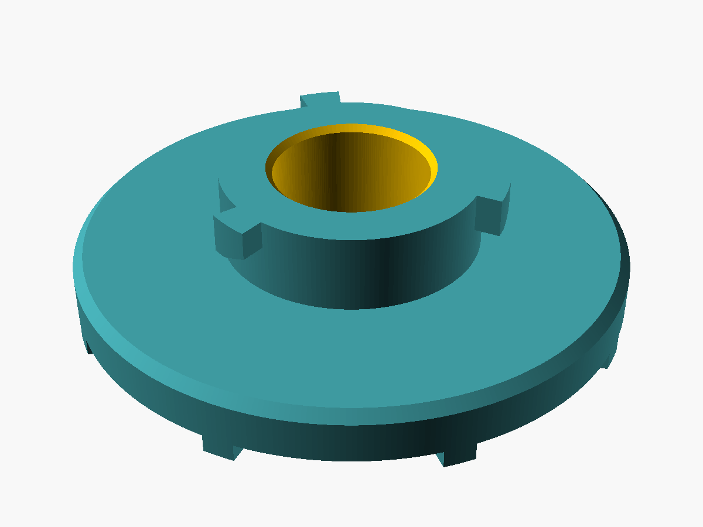

# Zanussi ZHT630X carbon filter screw

A replacement for the plastic retaining disc that holds the round carbon
filter on the Zanussi ZHT630X hood's mount. It locks like a bayonet: a ring
around the centre hole carries three lips that slide under the mount's three
hooks, and the ribs on the underside let you turn it by hand. Each lip is
attached to the ring along its whole inner face and sticks out 2 mm.

Built with [OpenSCAD](https://openscad.org) + [BOSL2](https://github.com/BelfrySCAD/BOSL2).



```
   section through a hook (centre on the left)

   hole │ ring  │lip│                 lip: 2 mm radially, 3 mm thick
        │███████│▓▓▓│
        │███████│   ← 3 mm gap: the mount's hook slides in here
        │███████│
   ▓▓▓▓▓▓▓▓▓▓▓▓▓▓▓▓▓▓▓▓▓▓▓▓▓▓▓▓▓▓▓   Ø43 mm plate, 4 mm thick
        █     █     █     █           grip ribs (print bed side)
        r=6     r=10 r=12
```

**Tighten clockwise, looking at it from below.**

## Dimensions

| Parameter | Meaning | Default |
|---|---|---|
| `plate_d`, `plate_t` | plate diameter, thickness | `43`, `4` |
| `hole_d` | centre hole | `12` |
| `hook_r` | radius of the hook centre line | `11` |
| `hook_w` | how far each lip sticks out of the ring | `2` |
| `hook_t` | lip thickness | `3` |
| `hook_gap` | plate top to the underside of the lip | `3` |
| `hook_len` | lip length along the arc | `3` |
| `lead_in`, `lead_in_len` | lip underside rises by 0.8 mm over its last 2 mm so the mount's hook finds the gap | `0.8`, `2` |
| `ring_h` | height of the ring above the plate (at least `hook_gap + hook_t`) | `6` |
| `tighten` | `cw_from_below` or `ccw_from_below` | `cw_from_below` |
| `grip_ribs`, `grip_h` | number and height of the grip ribs | `8`, `2` |

## Test the hooks first

```bash
openscad -o hook_test.stl -D 'part="hook_test"' zht630x_filter_screw.scad
```

A thin 30 mm disc with just the ring and lips: a quick print to check that it engages
the mount and locks in the right direction. If it is loose, reduce `hook_gap`;
if it will not turn in, raise it or increase `lead_in`.

## Print settings

| Setting | Value |
|---|---|
| Orientation | as exported: grip ribs on the bed, ring up |
| Supports | the lips overhang 2 mm out from the ring; add supports under them only if your printer droops there |
| Bridging | the plate bridges between the ribs, ~15 mm at the rim |
| Perimeters | 4+ |
| Infill | 40 %+ |
| Material | PETG or ASA (the hood gets warm); PLA works away from the cooktop's heat |

## Building

```bash
openscad -o zht630x_filter_screw.stl zht630x_filter_screw.scad
```
